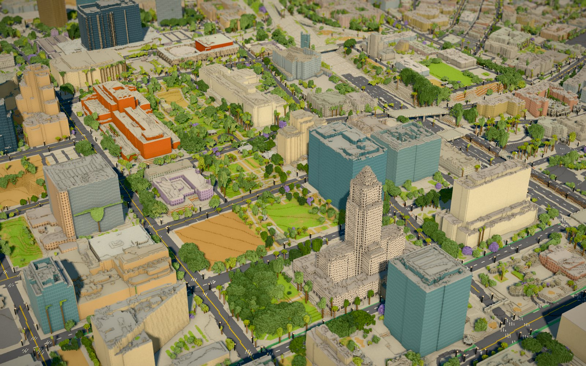
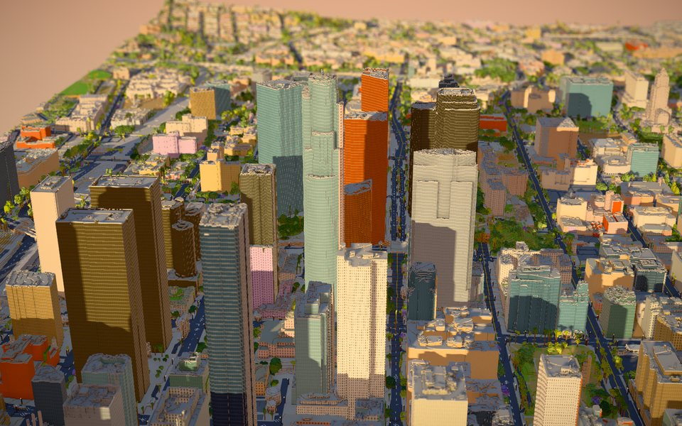
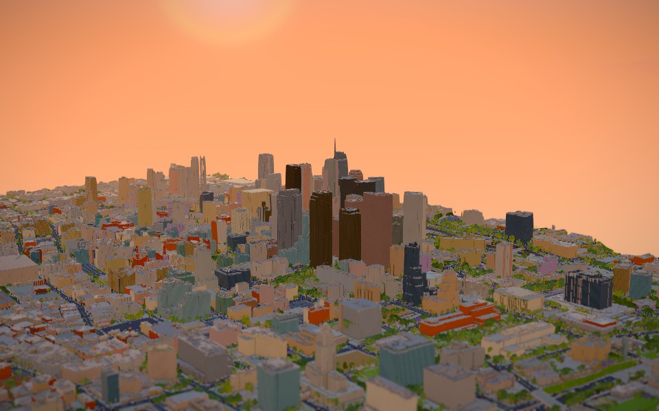
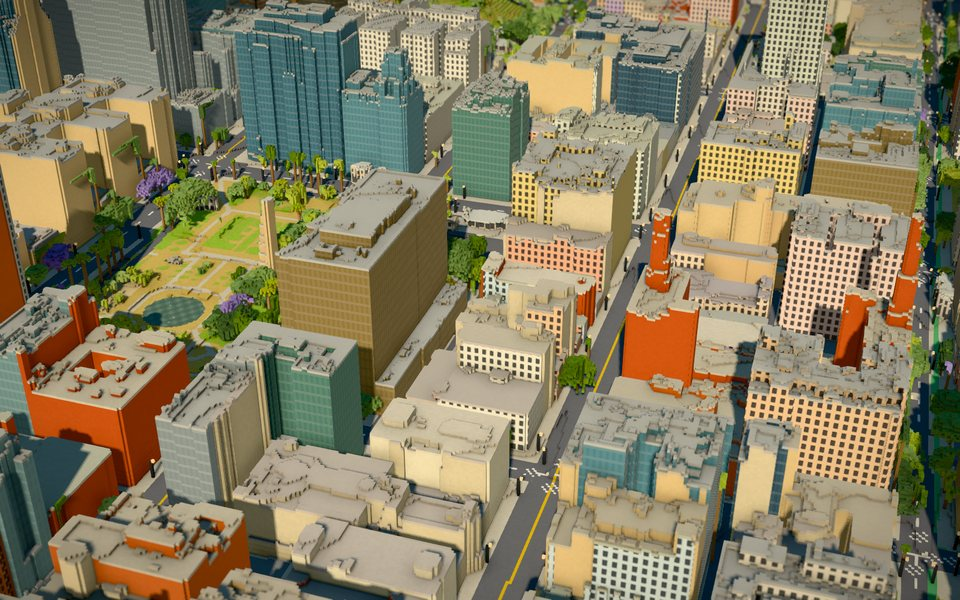
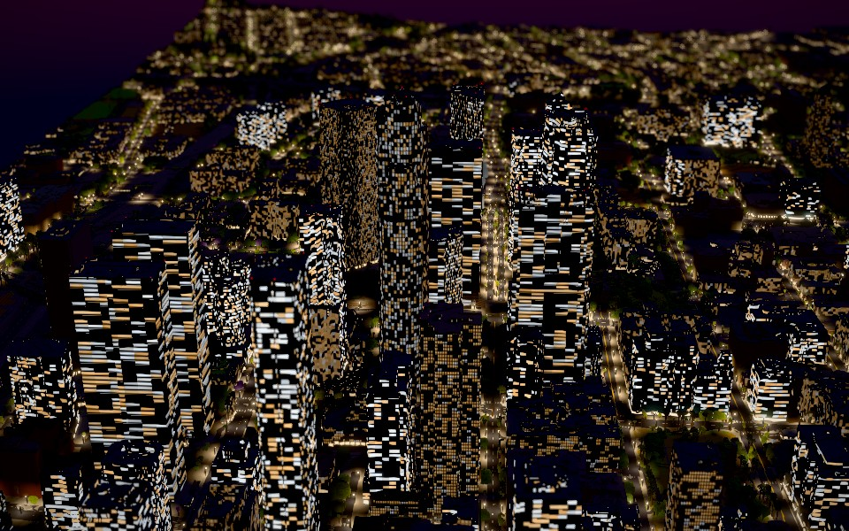

# DTLA in voxels

**Live: https://sigman78.github.io/dtla-voxel/**

[](https://sigman78.github.io/dtla-voxel/?view=civic&hour=10.5)

| | |
|---|---|
| [](https://sigman78.github.io/dtla-voxel/?view=bunkerhill&hour=15.8) | [](https://sigman78.github.io/dtla-voxel/?cam=4052,647,2285,2007,196,744&hour=16.4) |
| Bunker Hill at golden hour | The skyline at sunset, from the east |
| [](https://sigman78.github.io/dtla-voxel/?view=historic&hour=13) | [](https://sigman78.github.io/dtla-voxel/?view=bunkerhill&hour=19.5) |
| Broadway and Pershing Square | Bunker Hill at night |

Click a picture to open that view in the live viewer.

A 4.2 × 3.6 km diorama of downtown Los Angeles at 1 m voxels, with a southern-California palette:
sun-bleached stucco, Beaux-Arts terracotta, teal glass towers, cool white roofs, palms, jacarandas, golden dry
grass, and an amber haze at golden hour. The grid is rotated 52° so it lines up with the DTLA street grid, which
keeps walls from staircasing. The map runs from the Convention Center to Chinatown, and from the Harbor Freeway
to the east bank of the LA River (Bunker Hill, Civic Center, the Historic Core, Little Tokyo, the Arts District,
the 6th Street Viaduct).

The approach and the viewer follow [warsaw-vibe-voxel](https://github.com/stared/warsaw-vibe-voxel) by Piotr Migdał
(MIT, see `LICENSE-warsaw-vibe-voxel`).

```sh
cd web && npm install && npm run dev     # http://localhost:5173
```

URL parameters: `view=` (default, bunkerhill, civic, littletokyo, viaduct, lalive, historic), `hour=19.5`,
`date=MM-DD`, `tilt=0`, `ui=0`, `lod=1|2|4|8`, `cam=x,y,z,tx,ty,tz`.

[Rendering profile](docs/rendering-profile.html): measured shadows, postprocessing, tile/worker memory and stationary labels,
including the shadow-cache implementation, correctness checks, summarized results and instructions for the local profiling harness.
Generated measurements, screenshots and validation reports in `artifacts/` are local, disposable outputs;
they are ignored by Git and are not required to build or run the viewer. Keep durable conclusions in `docs/`.

## Data and pipeline (scripts/)

| Source | Used for |
|---|---|
| **USGS 3DEP LiDAR, CA_LosAngeles_1_B23 (2023)**: public EPT point cloud, full density, 242 M points | Roof heights and shapes, tree canopies, freeway decks (bridge class), the viaduct's arches |
| **USGS 3DEP 1 m DEM** (same survey) | Bare ground under buildings and freeways |
| **USDA NAIP 2022** (0.6 m, RGB + near infrared) | Roof colours, vegetation (NDVI), lawn vs dry grass, the river's low-flow channel |
| **OpenStreetMap** (Overpass, fetched at build time) | 20 k building footprints, colours and materials, roads and lane markings, crosswalks, rail, parks, the river, landmarks |

This LiDAR survey only classifies ground and bridges, so the other classes are inferred:
- **Buildings** are OSM footprints, with their heights and roof shapes taken from the LiDAR.
- **Trees** are above-ground LiDAR where NDVI is green or the beam passed through (multiple returns).
  - Glass-facade echoes are filtered out.
- **Palms** are small isolated crowns on tall bare trunks.
  - They get a voxel trunk, a skirt of dead fronds and a star of fronds.
- **Street lamps** are placed every 36 m along road kerbs (OSM maps almost none in DTLA).
- **Crosswalks** follow mapped crossing paths and marking styles, with resolved bars or two border lines.
  Explicitly unmarked, ambiguous and grade-separated crossings stay unpainted; signals alone do not imply stripes.
  Paint is subdued at 2 m detail and omitted at 4/8 m and in the terrain fallback, where bars would become blotches.
  Yellow centerlines stop inside connected surface-road junctions; approach lines remain, without invented yellow boxes.

Downloads are cached outside the project, in `C:\data\dtla-voxel-cache` (override with `DTLA_CACHE`), because
D: is nearly full. The cache takes about 2.5 GB; the web data in `web/public/data` takes about 19 MB.

```sh
sh scripts/build_data.sh   # downloads (cached), then rasterise + voxelise: ~7 min, ~4 GB RAM
```

| Script | Step |
|---|---|
| `aoi.py` | Map extent and the rotated grid frame |
| `fetch_lidar.py`, `fetch_dem.py`, `fetch_naip.py`, `fetch_osm.py` | Downloads, reading only the area needed |
| `prep_lidar.py` | Point cloud to 0.5 m / 1 m rasters |
| `layers.py` | 2D fusion: ground, buildings, roofs, vegetation, palms, decks |
| `road_markings.py` | Road-oriented crosswalks, marking-tag checks and connected-junction yellow-line gaps |
| `roof_cleanup.py`, `roof_pilot.py` | Ten-building roof pilot: absolute-elevation decks, conservative equipment candidates and bounded audit output |
| `voxelize.py` | 3D fill in 128-row bands, so the full volume is never in memory; writes tiles, `terrain.bin` and `meta.json` |
| `palette.py` | The SoCal palette and material ids |
| `landmarks.py` | Labels, with facts |
| `landmark_overrides.py`, `landmark_catalog.py` | Bounded building identities, facade materials and local roof refinements |
| `obstruction_lights.py` | Roof/spire warning-light positions from exported tiles; metadata-only refresh supported |
| `tiles.py` | Tile format, unchanged from warsaw-vibe-voxel |

## Known limits

- **Wall colours** come from OSM where tagged, otherwise from a palette picked by building type and height.
  A [source-linked roster](docs/facade-color-roster.html) reviews 53 recognizable buildings;
  36 verified, footprint-bounded corrections take precedence over generic colours.
  Six landmarks have dedicated facade treatments; windows and veil recesses are procedural, not surveyed.
  See [landmark facade notes](docs/landmark-facades.md) for identities, references and remaining geometry limits.
- **Glass towers lean in NAIP**, so their roofs use a default grey instead of the photo colour.
- **Some rail-yard light masts** still read as small trees.
- **The 6th Street Viaduct's arches** are drawn as their top 3 m only, so they float slightly. Its cables aren't drawn.
- **The LA River** is built from the OSM centreline and the terrain, because the riverbank outline is cut open at
  the map edge. The channel is the flat bed plus its walls; the water is a ~14 m low-flow strip widened by NAIP wet
  pixels, not a measured water line.
- **Buildings finished after the 2023 flight** use their OSM height where it's tagged.
- **Roof cleanup is a bounded pilot**, enabled for ten identities in `scripts/roof_pilot.py`.
  It fits connected absolute-elevation plateaus, rejects supported slopes above 1.2% and curved patches,
  limits measured-surface leveling to 0.35 m and corrections to the previous voxel top to 3 m.
  Compact elevated objects receive a matte neutral material only above their supporting deck;
  their exact function is unverified. Custom landmark roofs, gardens and neighboring footprints are protected.
  `DTLA_ROOF_PILOT=0` disables the pass when rebuilding. Per-building height/class masks and JSON diagnostics
  are written to `$DTLA_CACHE/roof-pilot-review` (default `C:\data\dtla-voxel-cache\roof-pilot-review`);
  `DTLA_ROOF_AUDIT=0` suppresses these review artifacts. Helipads and imagery-derived roof colors remain future work.

## Roadmap

Follow-up work. Landmark facades are the current priority, with traffic next.

**Life on the streets**
- [ ] **Traffic**: cars on the street grid and the 110 / 101 / 10 freeways, with headlight and taillight streams after dark.
- [ ] **Metro**: trains on the A/E lines and the Union Station approach tracks, and buses on the main avenues.
- [ ] **People** on Broadway, in Grand Park and at LA Live on event nights.

**Windows and facades**
- [x] **Building color normalization, first pass**: 36 source-supported facade corrections, including muted rose granite, pale stone, turquoise terra-cotta and dark bronze; preserve the generic palette and lighting mood.
- [ ] **Color roster follow-up**: resolve the 17 provisional entries and add material zoning, contrasting trim and building-specific glazing proportions. The [checked roster](docs/facade-color-roster.html) records evidence and limitations.
- [ ] **Realistic windows**: floor height and window rhythm from `building:levels` and building type, so curtain-wall towers, punched-window lofts and warehouses each look different.
- [ ] **Lit windows by use**: offices empty out after 7 pm, residential lofts fill up, hotels stay half lit (from OSM building use and POIs).
- [ ] **Shop fronts and signs**: ground-floor retail bands along Broadway, Spring and 7th, plus the historic theatre marquees.
- [ ] **Rooftop helipads**: the red "H" pads on 1970s–2000s towers (required by the LA fire code until 2014).
- [x] **Roof cleanup pilot**: ten named buildings, starting with Kenneth Hahn Hall of Administration; fit supported flat decks in absolute elevation, preserve separate tiers and uncertain slopes, and give compact raised equipment candidates a neutral material.
- [ ] **Roof cleanup expansion**: review pilot results before city-wide use; add evidence-backed equipment identities, roof material colors, communications structures and helipad markings.

**Landmark facades**, hand-tuned beyond what 1 m LiDAR shows:
- [x] First facade pass: City Hall stone/windows and solid crown, The Broad's shaded veil pattern,
  Disney Hall steel, Union Station stucco/arches, and distinct glazing on both towers.
- [x] Building-local facade frames and exact footprint anchors for landmark labels.
- [x] The Broad's soft veil lighting and a window-free Wilshire Grand spire.
- [x] Model-derived red warning lights on 18 towers, including Wilshire Grand's tip beacon.
- [ ] Further City Hall geometry detail beyond the measured setbacks and pyramid (local plateau noise cleaned).
- [x] Disney Hall's authored 3D shells voxelized with real gaps, overhangs and separately lit glazing; registered against cached LiDAR and aerial imagery.
- [ ] Further Disney Hall as-built refinement beyond the licensed academic model, especially clipped peripheral sails and landscape interfaces.
- [ ] The Broad's lifted corners and physical veil depth beyond the surface pattern.
- [ ] Union Station's clock faces, arcades and refined tile-roof geometry.
- [ ] Detailed crowns of Wilshire Grand and U.S. Bank Tower.
- [ ] Angels Flight's two orange cars.
- [ ] The Bradbury Building and Grand Central Market signage.
- [ ] **Sixth Street Viaduct**: full arches down to the deck, and the suspension cables.

**Light and weather**
- [ ] **Marine layer**: a "May Gray / June Gloom" low-cloud mode.
- [ ] **Smoggy-gold haze** in summer, and clear blue days after rain.
- [ ] **Seasons**: jacarandas in bloom in May, and green lawns in winter against dry summer gold.
- [ ] **Glass reflections**: towers mirroring the sky and each other.
- [ ] **Water**: a moving surface in the LA River's low-flow channel.
- [ ] **Palms swaying** in Santa Ana winds.
- [ ] **Backdrop**: the San Gabriel Mountains and the Hollywood Hills as distant silhouettes, from the DEM.

**Coverage and data**
- [ ] **A bigger map**: Echo Park and Dodger Stadium, Boyle Heights across the river, and Exposition Park.
- [ ] **Better tree and pole sorting**: a classifier on LiDAR return shape plus NAIP, so rail-yard masts stop reading as trees.
- [ ] **Fresher data**: re-fetch OSM, and pick up newer NAIP and LiDAR when they're published.

**Viewer**
- [ ] **Tile retries**: retry a tile after a failed fetch (right now a CDN hiccup leaves a hole until reload).
- [ ] **Guided tour**: a flight between the landmarks that shows their facts.
- [ ] **Phone performance**: lighter shadows and a lower level of detail on small screens.

## License

Code: MIT (`LICENSE`). Generated data in `web/public/data` derives from OpenStreetMap (ODbL, © OpenStreetMap contributors)
and from USGS and USDA public-domain data. The Disney Hall shell derivative uses
[Russell.Zazueta.Rivera's model](https://doi.org/10.5281/zenodo.10382043), licensed
[CC BY 4.0](https://creativecommons.org/licenses/by/4.0/). It has been registered,
filtered and voxelized; source attribution and the reproducible transform are in
[the model manifest](scripts/assets/disney-shell.json).
